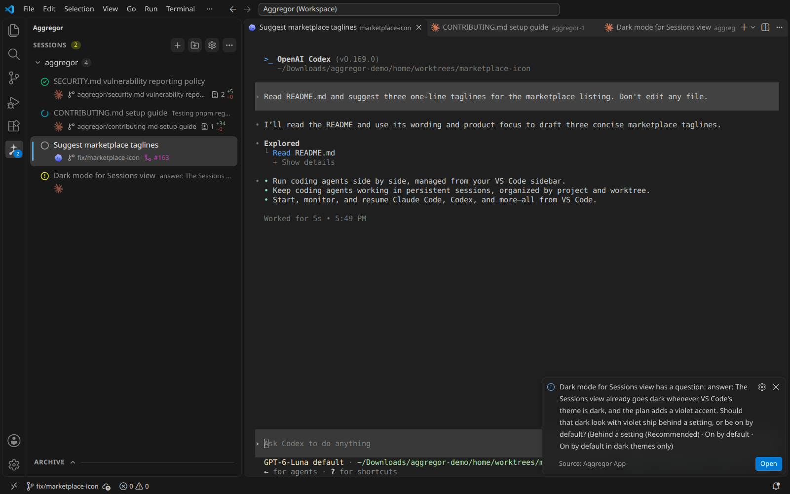
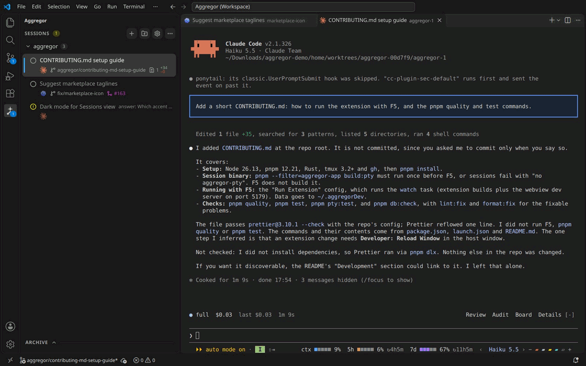
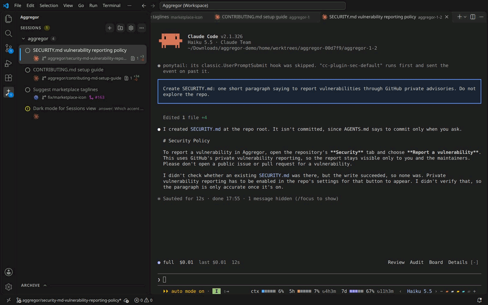
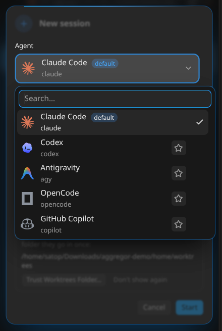

# Aggregor

Run Claude Code, Codex, Antigravity, OpenCode, GitHub Copilot, or any agent CLI, side by side in VS Code. Each session
is the agent's own terminal UI in an editor tab, kept alive in tmux, and one sidebar shows them all: what each is doing,
which worktree it works in and its pull request.

## What it does today

- **One sidebar for every session.** Projects with their sessions; click one to bring up its tab. Each row shows a live
  status: working, waiting on you, finished, error or exited.
- **Any agent.** Claude Code, Codex, Antigravity, OpenCode and GitHub Copilot are built in; add any other CLI with
  `aggregorApp.agents`.
- **Worktrees.** Start a session in the project's root or in a git worktree on a branch of its own. The window follows
  the session in front, so Explorer and Source Control show its changes, and its row counts the files and lines it
  changed. A broom on the project cleans up leftover worktrees and branches.
- **Pull requests.** A worktree session's row shows its branch's pull request, coloured open, draft, merged or closed;
  click it to open it. Needs the GitHub CLI (`gh`).
- **Sessions survive.** Agents run in tmux, so closing a tab, reloading or quitting VS Code doesn't stop them. Clicking
  a stopped session resumes its conversation.
- **Alerts.** A notification when a session out of view needs you or finishes, a system one when VS Code is in the
  background, and a badge counting the sessions waiting on you.
- **Import.** Bring a project's earlier Claude Code, Codex, OpenCode and Copilot conversations in as sessions.
- **Commit messages.** A Source Control button writes the commit message for the staged diff, then commits and pushes
  it; a setting turns each of the two off.

### A session in its own worktree

### Switching sessions

### Pick an agent

## Planned

- Create a pull request from a session.
- SSH: sessions on remote hosts, with live status.
- tmux bundled with the extension, so there is nothing to install.
- A tray icon listing sessions and their status, even while VS Code is closed.

## Requirements

- Linux or macOS. On Windows, open VS Code in WSL.
- tmux 3.2 or newer, and `gh` for pull requests. When either is missing, Aggregor offers to install it.
- At least one agent CLI on your `PATH`.

## Get started

Open **Aggregor** in the activity bar, press **+** on a project, pick an agent and where it works, and start.

The full roadmap is in [ROADMAP.md](ROADMAP.md), and problems go in
[issues](https://github.com/m-salman-afzal/aggregor/issues). To work on Aggregor, read [AGENTS.md](AGENTS.md).
